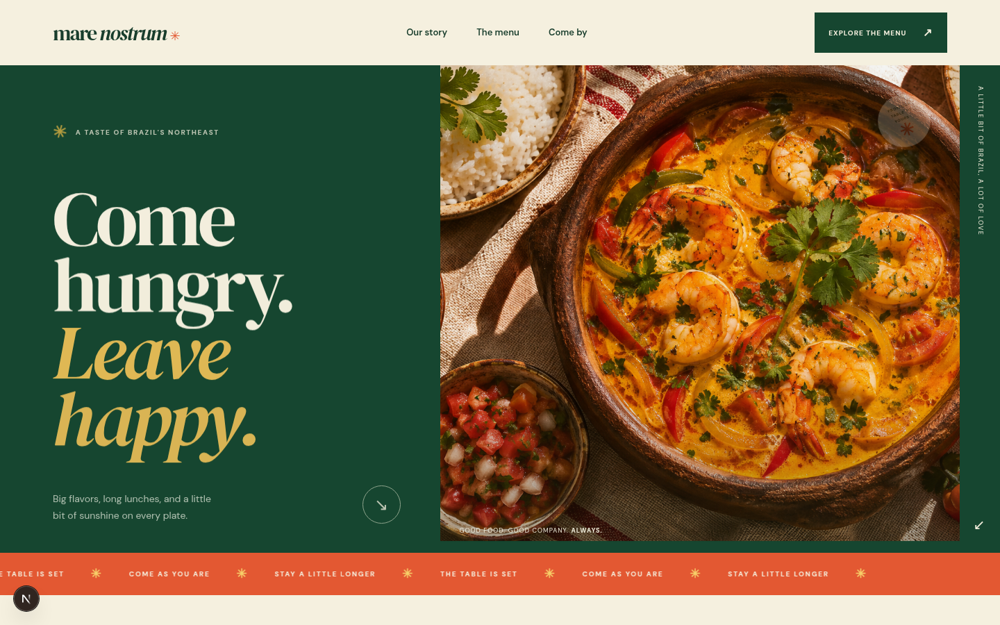

# Mare Nostrum

A restaurant website concept inspired by the food and hospitality of Brazil's Northeast. The single-page experience introduces the restaurant's story and lets visitors explore a sample menu.



## Highlights

- Responsive layout with mobile navigation and links to each section.
- Interactive menu with seafood, regional dishes, and desserts.
- Scroll animations with support for reduced-motion preferences.
- Keyboard focus indicators and accessible labels for navigation and menu controls.

This is a fictional restaurant concept with sample content; it does not take reservations or orders.

## Built with

Next.js App Router, React, TypeScript, and CSS, with Tailwind CSS available in the project.

## Run locally

Requirements: Node.js 20.9 or newer and npm.

```sh
npm ci
npm run dev
```

Open [localhost:3000](http://localhost:3000).

For a production build and lint check:

```sh
npm run build
npm run lint
```

The page is assembled in `app/page.tsx` from the sections in `components/`. Menu content lives in `data/menu.ts`, styles in `app/globals.css`, and images in `public/assets/`.
